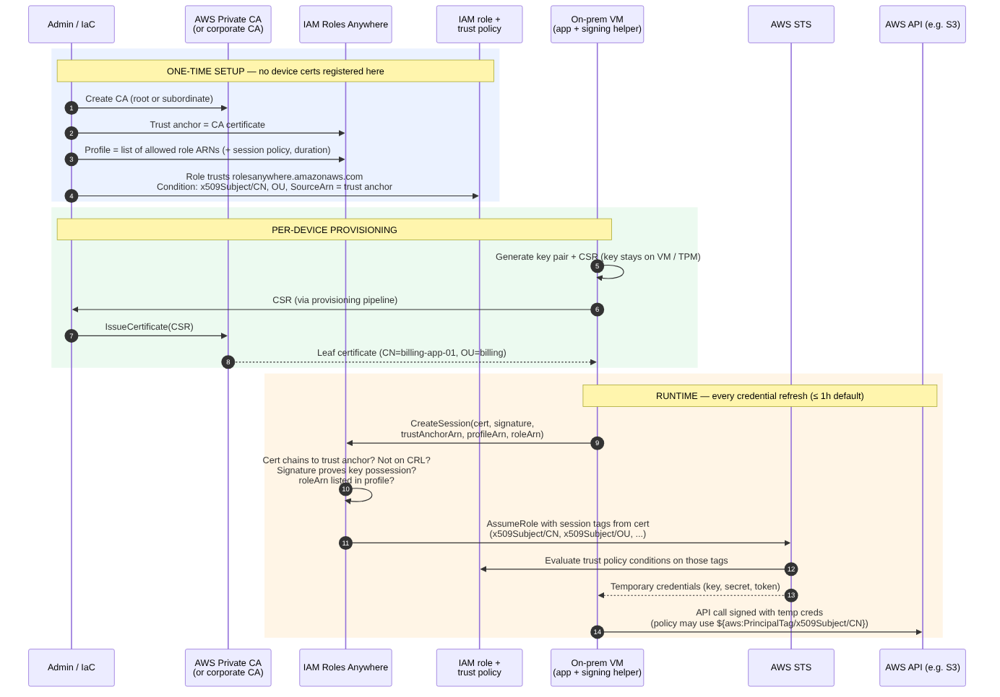
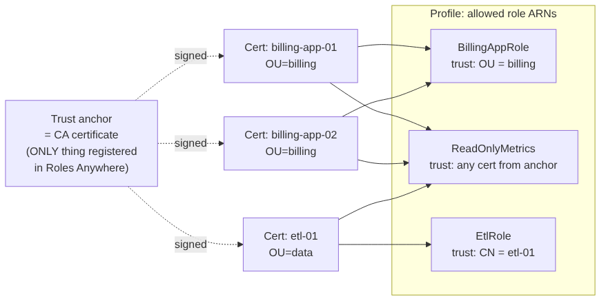
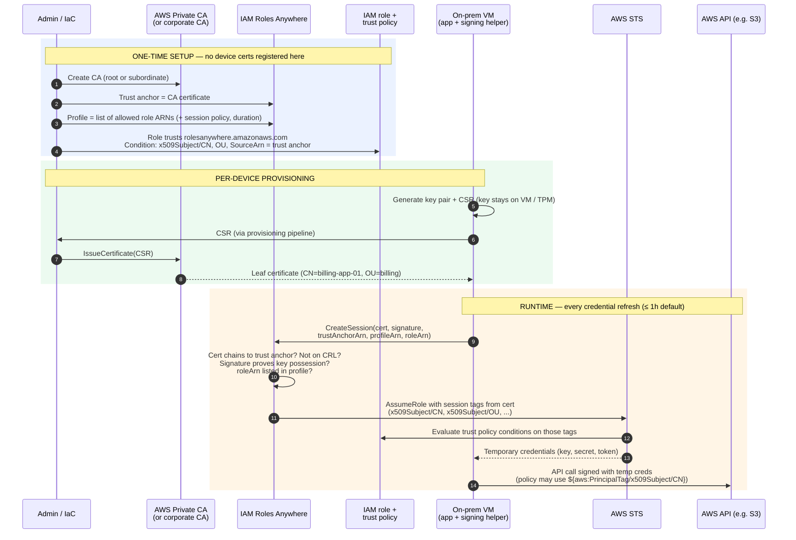
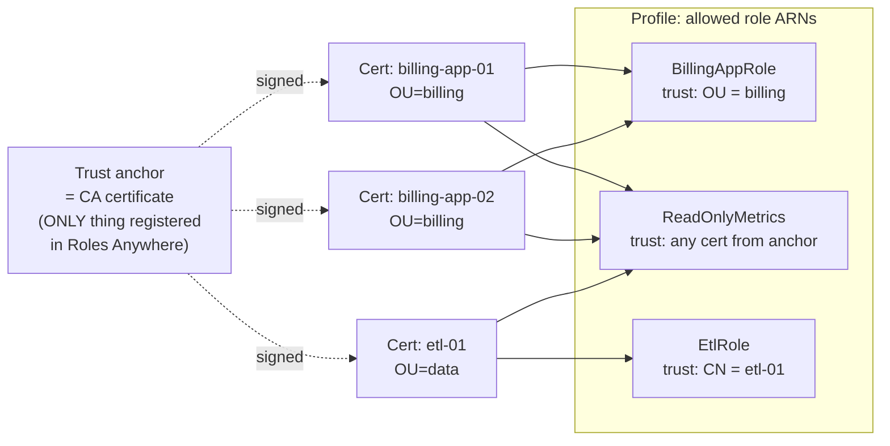

# D1-02 · IAM Advanced (roles, federation for workloads, policy evaluation)

> **Owner:** Claude · **Created:** 2026-10-29 · **Exam domain:** 1 (Organizational Complexity, 26%)
> **Status:** 🟡 In progress (session 2: Orgs / AuthN / AuthZ / IAM)
> Related: [[D1-01 Organizations & Control Tower]] · [[D1-03 Federation & Identity Center]] · `../10_feature-facts_claude.md`

---

## 1. Q: How does an on-prem workload (app in a VM) use an IAM role?

### 1.1 Mental model
A role has no credentials of its own. It is **permissions + a trust policy** that says *who may call STS to get temporary credentials for it*.
So the real question is always: **how does the caller prove its identity to STS?**

| Where the workload runs | Who vouches for its identity | STS call underneath |
|---|---|---|
| EC2 / Lambda / ECS on AWS | AWS itself (instance metadata, task metadata) | AssumeRole by the service on your behalf |
| On-prem VM, server | **Your PKI** (X.509 certificate) → **IAM Roles Anywhere** | `rolesanywhere:CreateSession` → temporary STS creds |
| On-prem with an OIDC issuer (K8s, SPIFFE, CI system) | Your OIDC IdP token | `AssumeRoleWithWebIdentity` |
| On-prem **humans** | Corporate IdP (AD, Okta) via SAML / Identity Center | `AssumeRoleWithSAML` |
| On-prem server managed by Systems Manager | SSM hybrid activation (code + ID) | SSM service assumes the instance's service role |
| IoT device (set-top box, sensor) | Device X.509 cert in IoT Core | IoT **credentials provider** + role alias |

### 1.2 IAM Roles Anywhere (the main answer for "app on an on-prem VM")
1. **Trust anchor**: register your CA in Roles Anywhere. Either **AWS Private CA** or your own external CA (upload the CA cert bundle).
2. **Profile**: lists which roles may be assumed, plus optional session policies / managed policies to cap permissions further. Session duration default 1 h, up to 12 h.
3. **Role trust policy**: principal `rolesanywhere.amazonaws.com`, actions `sts:AssumeRole`, `sts:TagSession`, `sts:SetSourceIdentity`. Narrow it with conditions on certificate attributes mapped to principal tags, e.g. `aws:PrincipalTag/x509Subject/CN = billing-app-01`, and `aws:SourceArn` = the trust anchor ARN.
4. **On the VM**: install the **credential helper** (`aws_signing_helper`). It signs a CreateSession request with the cert's private key and returns temporary creds. Plug it into the SDK/CLI via `credential_process` in `~/.aws/config`, so app code just uses the default credential chain. The helper can also serve creds on a local IMDS-like endpoint (`serve`) or keep a credentials file refreshed (`update`).
5. Revocation: import a **CRL** into Roles Anywhere; disable the trust anchor in an emergency. Private key can live in a TPM / PKCS#11 HSM.

Net effect: **no long-lived access keys on the server**; the cert is the long-lived secret, the AWS creds are short-lived and auto-rotated.

### 1.3 The other options, and when the exam wants them
- **SSM hybrid activation**: registers the server as a managed node (`mi-…`) with an IAM service role so you can use Run Command, Patch Manager, Session Manager, Inventory on-prem. It is for *managing the server*, not the go-to for giving the app its own AWS identity. Also the base for **ECS Anywhere** (task roles work on-prem) and **EKS Hybrid Nodes**.
- **OIDC federation (`AssumeRoleWithWebIdentity`)**: when the workload already gets OIDC tokens (on-prem Kubernetes with service-account tokens, GitHub/GitLab CI). Create an IAM OIDC provider, trust it in the role with `sub`/`aud` conditions.
- **SAML / IAM Identity Center**: for people, not machines. Identity source = AD (via AD Connector or AWS Managed Microsoft AD) or an external SAML IdP (Entra ID, Okta) → permission sets → roles in each account.
- **IoT credentials provider**: device cert → role alias → temporary creds to call S3, DynamoDB, Kinesis directly. The device equivalent of Roles Anywhere.
- **IAM user access keys on the box**: legacy. On SAP it is the **distractor**. Only acceptable if nothing else fits, and then rotated via Secrets Manager.

### 1.4 Exam cue → answer
| Phrase in the question | Answer |
|---|---|
| "on-premises servers need to call AWS APIs, **avoid long-term credentials**, company already has a PKI / certificates" | **IAM Roles Anywhere** |
| "patch / run commands / inventory on-premises servers alongside EC2" | **SSM hybrid activations** (managed instances) |
| "run containers on-prem managed by ECS" | **ECS Anywhere** (task role + SSM agent) |
| "on-prem CI / Kubernetes with OIDC tokens" | IAM OIDC provider + `AssumeRoleWithWebIdentity` |
| "employees sign in with corporate AD credentials to the console/CLI" | **IAM Identity Center** (or SAML 2.0 federation) |
| "millions of devices upload directly to S3 with per-device identity" | **IoT Core credentials provider** |
| "store access keys in a config file on the server and rotate" | ❌ usually wrong when Roles Anywhere is an option |

### 1.5 Follow-up: can KMS be the private CA?
**No.** KMS can hold an asymmetric key (RSA/ECC) and sign bytes with it, but it is not a CA: it does not issue X.509 certificates, manage certificate lifecycle, or publish CRL/OCSP. It cannot be a Roles Anywhere trust anchor.

| Service | What it is | When the exam wants it |
|---|---|---|
| **AWS Private CA** | Managed private CA: issues certs, hierarchy (root/subordinate), CRL/OCSP, keys in AWS-managed HSMs. Integrates with ACM, Roles Anywhere, IoT, EKS. Has a cheaper **short-lived certificate mode** (certs valid ≤ 7 days) | "private certificates for internal services / mTLS / Roles Anywhere, least operational overhead" |
| **ACM** | Issues/renews **public** certs (free) and deploys to ELB, CloudFront, API Gateway. Private certs only *through* Private CA | "TLS on ALB/CloudFront with auto-renewal" |
| **KMS** | Encryption keys, envelope encryption, asymmetric sign/verify. Asymmetric private key never leaves KMS | "sign/verify data, encrypt at rest", not "issue certificates" |
| **CloudHSM** | Single-tenant HSM you control. Can hold the CA key for **your own CA software** (e.g. Microsoft AD CS) | "company must keep sole control of CA keys in dedicated FIPS 140-3 Level 3 HSM" |

DIY corner (not an exam answer): run your own CA software that signs with a KMS asymmetric key, then register that CA's certificate as an *external* trust anchor in Roles Anywhere. Possible, but you own issuance, renewal and revocation.

---

### 1.6 Follow-up: is the CSR flow the same with AWS Private CA?
**Yes, the standard CSR flow is supported.** Terminology: the CA's own cert is the **CA certificate** (= the Roles Anywhere trust anchor). What each service/VM gets is an **end-entity (leaf) certificate** signed by that CA.

**Path A: you generate the key (best for Roles Anywhere on a VM)**
```bash
openssl req -new -newkey rsa:2048 -nodes -keyout app.key -out app.csr -subj "/CN=billing-app-01/O=ExampleCorp"
aws acm-pca issue-certificate --certificate-authority-arn $CA_ARN --csr fileb://app.csr \
  --signing-algorithm SHA256WITHRSA --validity Value=30,Type=DAYS \
  --template-arn arn:aws:acm-pca:::template/EndEntityClientAuthCertificate/V1
aws acm-pca get-certificate --certificate-authority-arn $CA_ARN --certificate-arn $CERT_ARN   # cert + chain
```
Private key never leaves the VM (can live in a TPM). Catch: `IssueCertificate` itself needs AWS creds, so issuance runs from a provisioning pipeline / admin tooling, not from the not-yet-trusted VM. Renewal is **your** job (re-run before expiry).

**Path B: ACM generates the key** ("request private certificate" in ACM, backed by your Private CA). ACM auto-renews. Fine for ALB/CloudFront/API Gateway; for a VM you'd have to **export** cert + key (passphrase-protected) and redeploy on every renewal, so the key was born in AWS.

**Path C: auto-enrollment connectors**
- **Connector for Active Directory**: domain-joined Windows machines/users auto-enroll from Private CA via Group Policy, no AD CS servers to run.
- **Connector for SCEP**: MDM-managed mobile/devices enroll via SCEP.
- Kubernetes: cert-manager + `aws-privateca-issuer`.

**Same CSR dance for the CA itself**
- Root CA in Private CA: it generates its CSR and you self-sign it (RootCACertificate template).
- **Subordinate CA chained to an existing on-prem root**: download the Private CA's CSR → sign it with the corporate root offline → import the signed CA cert back. Exam cue: *"keep existing on-prem root CA, offload issuing to AWS"*.
- If the company already has a PKI, Roles Anywhere can trust that CA directly; **Private CA is optional**.

Revocation: `revoke-certificate` → Private CA publishes CRL to S3 (or OCSP); import the CRL into Roles Anywhere so revoked certs can't create sessions.

---

### 1.7 Follow-up: how does a certificate link to a role? One cert ↔ many roles?
**Key correction: device certs are never registered in Roles Anywhere.** Only the **CA certificate** is (the trust anchor). Any cert that chains to it is *authenticated*; which role it may use is decided at request time.

**The link = 3 checks at `CreateSession`** (the signing helper passes `--trust-anchor-arn --profile-arn --role-arn`):
1. **Trust anchor**: cert chains to the registered CA, not expired, not on the imported CRL; signature proves possession of the private key.
2. **Profile**: the requested `roleArn` is in the profile's `roleArns` list.
3. **Role trust policy**: Roles Anywhere turns cert fields into **session tags** (`x509Subject/CN`, `x509Subject/OU`, `x509Issuer/...`, `x509SAN/DNS`, ...) and the trust policy's conditions on those tags must match. *This is the real cert→role binding.*

```json
{
  "Effect": "Allow",
  "Principal": { "Service": "rolesanywhere.amazonaws.com" },
  "Action": ["sts:AssumeRole", "sts:TagSession", "sts:SetSourceIdentity"],
  "Condition": {
    "StringEquals": { "aws:PrincipalTag/x509Subject/OU": "billing" },
    "ArnEquals":    { "aws:SourceArn": "arn:aws:rolesanywhere:us-west-2:111122223333:trust-anchor/TA_ID" }
  }
}
```
⚠️ A trust policy with **no** cert-attribute condition lets **every** cert from that CA assume the role.

**Cardinality: many-to-many**
- **One cert → many roles**: yes. Call CreateSession with a different `--role-arn` (e.g. separate `credential_process` profiles in `~/.aws/config`). Allowed if each role is in a profile and its trust policy matches the cert. One role per session, though.
- **Many certs → one role**: yes, the normal fleet pattern (all `OU=billing` certs share `BillingAppRole`).
- **ABAC for per-device scoping with one role**: use the tag in the permissions policy, e.g. S3 resource `arn:aws:s3:::telemetry/${aws:PrincipalTag/x509Subject/CN}/*` → each device writes only its own prefix. Avoids one role per device.
- Profiles can also attach session policies / managed policies to further cap every session, and custom **attribute mappings** control which cert fields become tags.




<details><summary>Mermaid source</summary>




</details>

---

### 1.8 Follow-up: does the app code need the profile and role ARNs?
**No. The config needs them, not the code.** The app uses the normal SDK default credential chain, the same as on EC2.

The ARNs (plus cert and key paths) go to the **signing helper**, wired in through `~/.aws/config`:
```ini
[profile billing]
credential_process = aws_signing_helper credential-process \
    --certificate /etc/pki/billing-app-01.pem \
    --private-key /etc/pki/billing-app-01.key \
    --trust-anchor-arn arn:aws:rolesanywhere:us-west-2:111122223333:trust-anchor/TA_ID \
    --profile-arn      arn:aws:rolesanywhere:us-west-2:111122223333:profile/PROFILE_ID \
    --role-arn         arn:aws:iam::111122223333:role/BillingAppRole
```
- The app selects it with `AWS_PROFILE=billing` (or the SDK's profile option). Need two roles? Add two `[profile ...]` blocks.
- The SDK calls the helper when creds are missing or near expiry, so **refresh is automatic**.
- Alternative: `aws_signing_helper serve` exposes a local **IMDS-like endpoint**; point the SDK at it with `AWS_EC2_METADATA_SERVICE_ENDPOINT`. The app then behaves exactly as if it were on EC2.
- The ARNs are **not secrets**. The secret is the private key; protect that (file permissions, TPM, PKCS#11).

EC2 comparison: on EC2 the role binding is set at launch (instance profile) and IMDS serves creds. On-prem the binding lives in this config file, and the helper plays the role of IMDS.

---

### 1.9 Follow-up: is this really better than an access key + secret?
Fair challenge: both need a secret stored securely on the box, and Roles Anywhere adds PKI to run. The gains are real but specific:

| Concern | IAM user access key | Roles Anywhere cert |
|---|---|---|
| Kind of secret | **Shared secret**, a copyable string. AWS holds it too | **Asymmetric private key**, only on the device. Can be **non-exportable** (TPM/HSM): usable only while the attacker is *on* the box, can't be copied off |
| If it leaks | Valid **until someone rotates it** (often years), usable from anywhere | Leaked AWS creds die in ≤ 1 h. Cert lifetime is your policy (days, or ≤ 7 days in short-lived mode) |
| Expiry / rotation | Never expires. Manual rotation, so in practice often skipped | AWS creds rotate automatically. Cert renewal can be **automated** (cert-manager, AD auto-enrollment, provisioning pipeline) |
| Fleet scale | One IAM user per server (account quota, 2 keys each) **or** one key shared by all, so no attribution | One role for the fleet, unique identity per device via CN. **ABAC** with `${aws:PrincipalTag/x509Subject/CN}` |
| Revoke one device | Shared key → rotate everywhere | Revoke one cert (CRL); the rest keep working |
| Audit (CloudTrail) | "user billing-svc" from N servers | Session tied to the cert (serial/CN), so per-device trail |
| Governance | Must allow IAM users/keys in the org | Can **SCP-deny `iam:CreateUser`/`iam:CreateAccessKey`** org-wide, a clean "no long-term creds" rule |

**Where the skepticism is right**
- The private key still has to be protected. Without a TPM/HSM, a stolen key file + cert works until expiry/revocation (still bounded, unlike an access key).
- Real PKI overhead if the company has none: CA ops, renewal automation, CRL publishing. For 3 servers it may not pay off.
- The CA becomes a crown jewel: a compromised CA can mint identities for every role that trusts it. Hence tight trust-policy conditions and a dedicated CA per trust anchor.
- Bootstrapping just moves: something trusted still has to get the first cert onto the box.

**Bottom line**: it turns *one long-lived, copyable, shared secret* into *a per-device, possibly non-exportable identity plus short-lived credentials*. Worth it at fleet scale, with existing PKI, or under compliance rules. **Exam lens**: AWS always prefers temporary credentials; "store access keys on the server" is almost always the wrong option.

---

## 2. Certificates for private domains: ACM or Private CA?

**Rule: a public CA (ACM public) can only issue for names in public DNS that you can prove you control.** It cannot issue for `corp.local`, `*.internal`, single-label names or private IPs (CA/Browser Forum rules).

| Situation | Answer | Client trust |
|---|---|---|
| Real public domain you own, resolved **privately** (e.g. `api.internal.example.com` in a Route 53 private hosted zone) | **ACM public cert** still works. Put the DNS-validation CNAME in the **public** zone of `example.com` | Automatic (public root) |
| Truly private names (`billing.corp.local`), or policy says internal names must not appear in public CT logs | **ACM private cert issued by AWS Private CA** | Clients must trust your Private CA root (push via GPO, MDM, AMI, container image) |
| mTLS client certs, device/IoT identity, Roles Anywhere | **Private CA** (directly or via ACM) | Your root |

**ACM + Private CA together** (the usual private answer): in ACM choose *Request a private certificate* → pick the Private CA. ACM generates the key, **auto-renews**, and deploys to **ALB/NLB** (and other ACM-integrated services) exactly like a public cert. Note: **CloudFront viewer certs must be public**.
- Cross-account: share the Private CA via **AWS RAM**, so app accounts request private certs from a central CA in a security account (exam pattern).
- Exportable private certs from ACM: for EC2/on-prem servers that terminate TLS themselves.

Exam cues: *"internal ALB, corporate domain not publicly resolvable, auto-renewal, minimal overhead"* → **ACM private cert from AWS Private CA**. *"Internal ALB but domain is a subdomain of our public domain"* → ACM public cert with DNS validation also works and needs no root distribution.

---

### 2.1 Glossary: how a root CA gets onto client machines
These are **not AWS IAM features**. They are the corporate tools that push settings (including trusted root certs) to company machines.

- **Group Policy (GPO)**: a Microsoft **Active Directory** feature. Domain-joined Windows machines pull settings from the domain controllers; a GPO can drop the Private CA root into every machine's *Trusted Root Certification Authorities* store. Unrelated to IAM groups. AWS angle: works the same with **AWS Managed Microsoft AD**, and **Connector for AD** uses GPO for cert auto-enrollment.
- **MDM (Mobile Device Management)**: Intune, Jamf, Workspace ONE, etc. Push configuration profiles (Wi-Fi, VPN, **trusted root certs**, client certs) to laptops and phones. AWS angle: **Connector for SCEP** lets the MDM enroll device certs from Private CA.
- **Linux / servers**: config management (Ansible, Puppet, Chef, **SSM Run Command / State Manager**) copies the root to `/etc/pki/ca-trust/source/anchors/` (RHEL) or `/usr/local/share/ca-certificates/` (Debian) and runs `update-ca-trust` / `update-ca-certificates`.
- **Bake it in**: include the root in the **AMI** (EC2 Image Builder) or the **container base image**, so every new instance trusts it from boot.
- Java apps may use their own truststore (`cacerts`), which needs the root imported separately.

---

## 3. Role trust policy

### 3.1 Mental model: a role has two policies
| | **Trust policy** | **Permissions policy** |
|---|---|---|
| Answers | **WHO may become this role** (call `sts:AssumeRole*`) | **WHAT the role can do** once assumed |
| Policy type | **Resource-based** policy; the role *is* the resource (so no `Resource` element) | Identity-based policy |
| Key element | `Principal` (+ `Condition`) | `Action` / `Resource` (+ `Condition`) |

Correction: the trust policy doesn't say "which resources the role applies to". It says **which principals may assume it**. EC2 is just one principal (`ec2.amazonaws.com`).

### 3.2 Where trust policies show up
| Who assumes | `Principal` | STS call / notes |
|---|---|---|
| AWS service | `{"Service": "ec2.amazonaws.com"}`, `lambda`, `ecs-tasks`, `glue`, `states`, `pods.eks` ... | Service calls AssumeRole for you |
| Another account (cross-account) | `{"AWS": "arn:aws:iam::222233334444:role/Deployer"}` or `...:root` | `AssumeRole`. Third party (SaaS vendor) → add `sts:ExternalId` condition (confused deputy) |
| SAML IdP (AD FS, Okta, Entra) | `{"Federated": "arn:aws:iam::acct:saml-provider/Okta"}` | `AssumeRoleWithSAML`. Identity Center permission sets create these roles for you |
| OIDC IdP (EKS IRSA, GitHub Actions, Cognito) | `{"Federated": "arn:aws:iam::acct:oidc-provider/..."}` | `AssumeRoleWithWebIdentity`, condition on `sub` / `aud` |
| On-prem via certs | `{"Service": "rolesanywhere.amazonaws.com"}` | Conditions on `x509Subject/*` (section 1.7) |
| Service-linked roles | Fixed by AWS | You can't edit the trust policy |

### 3.3 Why not put it in the permissions policy with ABAC-style conditions?
1. **Ownership**: the role owner must control who becomes the role, just like a bucket owner controls the bucket policy. If only the caller's side decided, any account could grant itself access to your role.
2. **Service principals have no identity policy**: `ec2.amazonaws.com` isn't an IAM user/role in your account, so the only place to authorize it is a resource policy on the role.
3. **Different evaluation time**: the permissions policy is evaluated *after* you are the role, against the resources you touch. The trust policy is evaluated *at* AssumeRole.

**ABAC-style conditions do exist, inside the trust policy**: `sts:ExternalId`, `aws:PrincipalOrgID` (only principals from my org), `aws:PrincipalTag/...`, `aws:SourceArn` / `aws:SourceAccount` (confused deputy for services), `token.actions.githubusercontent.com:sub`, `saml:aud`.

### 3.4 The caller side still matters (both halves must allow)
- **Cross-account**: the caller's identity policy must allow `sts:AssumeRole` on the role ARN **and** the role's trust policy must trust the caller. Either missing = denied. (Plus SCPs in both accounts.)
- **Same account**: if the trust policy names the specific user/role ARN, that's enough. If it names the account (`:root`), the caller also needs an identity policy allowing `sts:AssumeRole`.
- `:root` in a trust policy means **"the account, delegating to its IAM admins"**, not the root user.

Exam cue: *"third-party vendor needs access to our account"* → cross-account role + **ExternalId**. *"Only accounts in our organization may assume"* → `aws:PrincipalOrgID` condition.

---

### 3.5 Service role vs service-linked role (Dojo Q, 2026-10-30)
| | **Service role** | **Service-linked role (SLR)** |
|---|---|---|
| Who creates it | You | The AWS service (or you, via `iam:CreateServiceLinkedRole`), from an AWS-defined template |
| Name / path | Anything you like | Fixed, e.g. `AWSServiceRoleForECS`, path `/aws-service-role/` |
| Trust policy | You write it (`ecs-tasks.amazonaws.com`, `ec2.amazonaws.com` ...) | **Fixed** to that one service, can't edit |
| Permissions | You write them | **Predefined by AWS**, can't edit. Only what the service needs (ECS: manage ENIs, register targets with ELB, etc.) |
| Lives in | The same account | The same account (not cross-account, not in the management account) |
| **Affected by SCPs?** | **Yes** | **No** |

Example in ECS: *task role* / *task execution role* = service roles you define. `AWSServiceRoleForECS` = the SLR ECS uses for its own plumbing.

**Dojo question takeaway**: SCP denying ECS actions had no effect → **SCPs do not affect service-linked roles**.
Distractor: "root-created". SCPs **do** restrict a member account's root user; they only skip the **management account**.

---

### 3.6 Service-linked roles explained: two different callers
```
 (A) Your principals                        (B) The ECS service itself
 users / roles / root of member account     using AWSServiceRoleForECS
        │  ecs:CreateService, RunTask,              │  ec2:CreateNetworkInterface,
        │  UpdateService, DeleteCluster ...         │  elasticloadbalancing:RegisterTargets,
        ▼                                           │  autoscaling, CloudWatch ...
   ┌─────────────┐   accepted request   ┌──────────▼──────────┐
   │  ECS API    │ ───────────────────► │ ECS control plane   │ ──► EC2 / ELB / ... in YOUR account
   └─────────────┘                      └─────────────────────┘
   SCP APPLIES here                     SCP does NOT apply here
```
- **(A)** Anyone in the member account calling ECS APIs uses their **own** IAM identity. An SCP denying `ecs:*` **does** block these, including the member account's root user.
- **(B)** After ECS accepts work, it keeps doing background plumbing on its own: keep desired task count, replace failed tasks, attach ENIs, register targets with the ALB. For that it assumes the SLR. **SCPs never restrict the SLR**, so that activity continues.
- "Root-created ECS cluster with an attached service-linked role" = the account's root user created the cluster; ECS auto-created `AWSServiceRoleForECS` in that account the first time. The SLR is account-wide for ECS, not per cluster.
- The Dojo question is loosely worded; the tested fact is simply **"SCPs do not affect service-linked roles"**.

**How to actually stop it**
1. SCP deny on `ecs:*` (or specific actions) → stops people/apps from making changes. ✅ works.
2. Stop the running workload: an allowed admin scales services to 0 / deletes services and cluster (before the SCP, or via an exempted admin role).
3. Delete the SLR once nothing uses it (`iam:DeleteServiceLinkedRole`).
4. Prevent it coming back: SCP deny `iam:CreateServiceLinkedRole` with `"StringEquals": {"iam:AWSServiceName": "ecs.amazonaws.com"}` plus deny `ecs:CreateCluster`. SLR creation is triggered by *your* principal, so the SCP applies to it.

Analogy: SCP = rule book for the tenant's staff. SLR = the building maintenance crew's master key; the rule book doesn't cover them. To stop the crew, stop the work orders (workload) and don't let anyone hire them again (deny SLR creation).

---

### 3.7 What control do you have over service-linked roles?
Precision first: an SLR is created **once per account per service** (sometimes per feature), the first time you use a service that needs to act on your behalf. Not per call.

| Lever | Control? | Notes |
|---|---|---|
| Edit trust / permissions policy | ❌ | Only the description is editable. No permissions boundary either |
| SCPs / RCPs | ❌ | Neither restricts SLRs |
| **Creation** | ✅ | Auto-creation happens under the **calling principal's** permissions (`iam:CreateServiceLinkedRole`). Deny it in IAM or an SCP with `iam:AWSServiceName` to keep a service out of an account |
| **Deletion** | ✅ (conditions) | `iam:DeleteServiceLinkedRole`, async (check `GetServiceLinkedRoleDeletionStatus`). Fails while resources still use it. Some can't be deleted while the feature is on (e.g. Organizations' SLR while the account is in the org) |
| **Resource-based policies** | ✅ | SLR is a normal principal there: a **KMS key policy** must allow it, and an explicit deny in a bucket/key policy blocks it |
| **Audit** | ✅ | CloudTrail records every call the SLR makes; IAM "last accessed" shows activity |
| **Custom suffix** (some services) | ✅ | e.g. Auto Scaling `AWSServiceRoleForAutoScaling_<suffix>`: separate SLRs per ASG so key policies can be scoped |

**Exam favourite**: ASG launches instances with **EBS volumes encrypted by a customer managed KMS key** and they fail to launch → the KMS **key policy** must grant `AWSServiceRoleForAutoScaling` (or the custom-suffix SLR) use of the key (`kms:CreateGrant`, `Encrypt/Decrypt/ReEncrypt*/GenerateDataKey*/DescribeKey`). Cross-account key: key policy + a grant for the SLR.

---

### 3.8 Where do you see SLRs being created?
You usually aren't asked: the service creates the SLR silently the first time you use the feature (console, CLI or CloudFormation). Some consoles mention it in small print.
- **IAM console → Roles**: names `AWSServiceRoleFor...`, *Trusted entities* = "AWS Service: ecs (Service-Linked Role)".
- **CLI**: `aws iam list-roles --path-prefix /aws-service-role/ --query 'Roles[].[RoleName,CreateDate]' --output table`
- **CloudTrail**: event `CreateServiceLinkedRole` (event source `iam.amazonaws.com`, logged in **us-east-1** as IAM is global). `userIdentity` = your principal that triggered it, `invokedBy` = the service (e.g. `ecs.amazonaws.com`).
- **Docs**: "AWS services that work with IAM" table has a *Service-linked roles* column.

---

---

### 3.9 `iam:PassRole`: handing a role to a service (discussed 2026-11-02, from D2-02 ASG)
**Not a role. It's a permission** on the *caller*. It allows "I may give role X to service Y so the service can assume it later." It is the **third check**, next to the two policies in 3.1:
| Check | Lives on | Asks |
|---|---|---|
| Trust policy | The role | May service Y assume this role? |
| Permissions policy | The role | What can the role do? |
| **`iam:PassRole`** | **The caller** (user/role doing the configuring) | **May this caller attach this role to a service?** |

**Why it exists: privilege escalation.** Without it, a developer limited to `ec2:RunInstances` could launch an instance with the `AdminRole` profile, SSH in, and become admin. PassRole makes the caller prove they're allowed to hand out *that specific* role.

**When it's checked:** at **configuration time**, in the API call where a role ARN is a parameter. Not when the service later assumes the role.
| You call... | Role passed |
|---|---|
| `ec2:RunInstances` / launch template / ASG create or update with an LT that has an instance profile | Instance profile's role → `ec2.amazonaws.com` |
| `lambda:CreateFunction` / `UpdateFunctionConfiguration` | Execution role |
| `ecs:RegisterTaskDefinition` | Task role + task execution role |
| `cloudformation:CreateStack --role-arn` | CFN service role (and *that* role then needs PassRole for any roles its resources use) |
| Glue jobs, Step Functions, CodeBuild/CodePipeline, SageMaker, EventBridge targets, Data Pipeline ... | That service's role |

**Typical least-privilege policy:**
```json
{
  "Effect": "Allow",
  "Action": "iam:PassRole",
  "Resource": "arn:aws:iam::111122223333:role/app/*",
  "Condition": { "StringEquals": { "iam:PassedToService": "ec2.amazonaws.com" } }
}
```
- Scope `Resource` to specific role ARNs or a **path** (`role/app/*`). **Never `*`.** `iam:PassRole` on `*` is a classic escalation finding.
- `iam:PassedToService` restricts which service may receive the role.

**Gotchas**
- PassRole is **permission-only, not an API**, so there's **no separate CloudTrail event**. It appears as an AccessDenied on the action that needed it (e.g. `RunInstances`, `CreateFunction`).
- The error text is `User ... is not authorized to perform: iam:PassRole on resource: arn:aws:iam::...:role/X`.
- Usually needs `iam:GetRole` / `iam:ListInstanceProfiles` as well so the console can show the role picker.

**Exam cues**
- "Developers can create Lambda / EC2 but must not escalate privileges" → PassRole limited to approved role ARNs/path + `iam:PassedToService`, often combined with a **permissions boundary** that developer-created roles must carry.
- "Pipeline / CloudFormation fails with `not authorized to perform iam:PassRole`" → add PassRole for that role to the **deploying** principal (or the CFN service role).
- ASG/EC2 "can't launch with instance profile" → the caller lacks PassRole on the instance profile's role. Compare the KMS key policy issue in 3.7.

---
## Q&A 2026-11-12 · Which AWS managed policies does the exam expect? (Dojo Q: dev users + view Organizations info → PowerUserAccess)
- Correction: `AdministratorAccess` = `Allow *:*`, so it **does** include Organizations. It loses because it's **too broad** (least privilege), not because it lacks Organizations.
- `PowerUserAccess` (approx.): `Allow` with **`NotAction: iam:*, organizations:*, account:*`** on `*`, plus a small allow-back list: `organizations:DescribeOrganization` (org info incl. management-account email), `account:GetAccountInformation`, `account:ListRegions`, `iam:CreateServiceLinkedRole`, `iam:DeleteServiceLinkedRole`, `iam:ListRoles`. = "build anything, but can't manage identities or the org".
- `SystemAdministrator` (job-function): EC2/ops-focused, no `organizations:DescribeOrganization` → fails the Orgs requirement.

| Policy | Means | Exam cue |
|---|---|---|
| `AdministratorAccess` | everything | almost never the least-privilege answer |
| `PowerUserAccess` | everything except IAM / Orgs / Account mgmt (+ DescribeOrganization, SLR create) | developers who build resources but mustn't manage users/permissions |
| `ReadOnlyAccess` | read all, **incl. data** (s3:GetObject, DynamoDB reads) | read-only operations |
| `ViewOnlyAccess` (job-function) | list/describe metadata, **no data** | "see what resources exist but not their contents" |
| `SecurityAudit` | read security config across services | auditors / security reviewers |
| `Billing` (job-function) | billing & cost console | finance; also needs IAM access to Billing activated by root |
| `SystemAdministrator`, `NetworkAdministrator`, `DatabaseAdministrator`, `DataScientist`, `SupportUser` (job-function) | scoped to the role | know they exist; rarely the keyed answer |
| `AWSOrganizationsReadOnlyAccess` | view the org | read-only org access |
| `AmazonSSMManagedInstanceCore` | SSM agent on an instance (D3-01) | instance not showing in Fleet Manager |
- Rule: *least privilege + "create resources" + "no IAM changes"* → **PowerUserAccess**. *"read metadata, not data"* → **ViewOnlyAccess**. *"auditors"* → **SecurityAudit**.

---
## Q&A 2026-11-12 · Cross-account role: restrict WHO in the source (management/delegated) account can assume it
Control lives in the **target role's trust policy**; the source account still has to grant `sts:AssumeRole` (both halves).
| Want | Trust policy |
|---|---|
| Source account decides who (delegate) | `Principal: {"AWS": "arn:aws:iam::SRC:root"}`; source admins grant `sts:AssumeRole` to a group/role via IAM |
| Only a specific role | `Principal: {"AWS": "arn:aws:iam::SRC:role/OpsRole"}` |
| Roles matching a pattern (incl. Identity Center permission sets) | Principal = SRC root + `ArnLike aws:PrincipalArn` `arn:aws:iam::SRC:role/aws-reserved/sso.amazonaws.com/*/AWSReservedSSO_OpsPermSet_*` |
| Users/roles with a tag (ABAC) | Principal = SRC root + `StringEquals aws:PrincipalTag/team = ops` (or session tags: `aws:RequestTag` + allow `sts:TagSession`) |
| Anyone in the org / an OU | `aws:PrincipalOrgID` / `aws:PrincipalOrgPaths` |
- **IAM groups are NOT principals** and there's no group condition key → group restriction = source side (group policy allows AssumeRole on the target role ARN), or tag the users.
- Prefer **trusting a role** (or `aws:PrincipalArn`) over a user. A specific-ARN principal breaks if the role is deleted/recreated (becomes an unique ID); `aws:PrincipalArn` condition doesn't.
- `ExternalId` = third parties (confused deputy), not needed inside your org.
- Management-account principals ignore SCPs, so the target trust policy is your control. The target role itself IS bound by SCPs. Best practice: keep humans/workloads out of the management account, use a delegated admin account.
